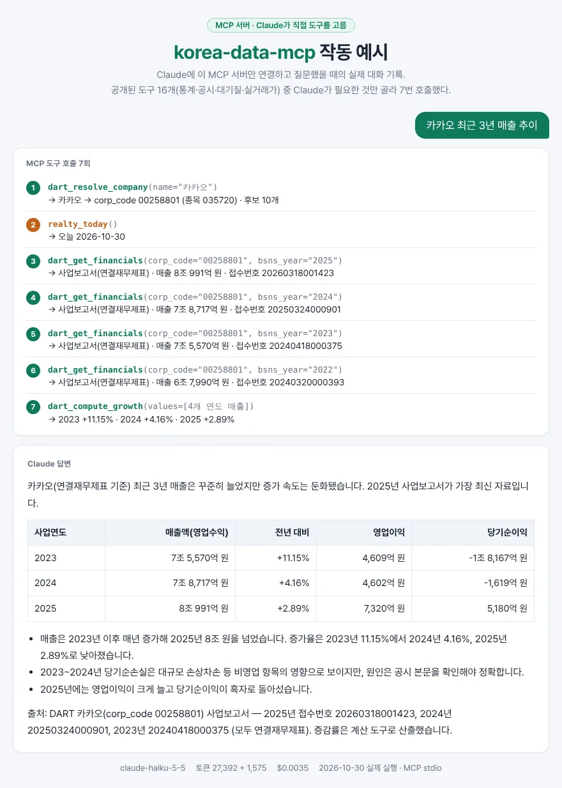

# korea-data-mcp

한국 공공데이터 4종을 **출처와 함께** 조회하는 MCP 서버.
Claude Desktop·Claude Code 같은 MCP 클라이언트에 꽂으면, 모델이 국가통계·전자공시·대기질·아파트 실거래가를
직접 조회하고 계산은 코드 도구로 한다.

| 도메인 | 도구 | 데이터 | 필요한 키 |
|---|---|---|---|
| `kosis_*` (4) | 통계표 검색 → 항목 조회 → 수치 조회 → 증감 계산 | KOSIS 국가통계포털 | `KOSIS_API_KEY` |
| `dart_*` (3) | 회사 → 재무제표(접수번호 출처) → 증감률 계산 | OpenDART 전자공시 | `OPENDART_API_KEY` |
| `air_*` (4) | 서울 자치구 → 대기질·기상 관측 → 외출 조언 | 에어코리아, 기상청 | `DATA_GO_KR_SERVICE_KEY` |
| `realty_*` (5) | 주소 → 실거래 → 시세 추이·비교 단지 | 국토교통부 실거래가 | `DATA_GO_KR_SERVICE_KEY` |

키가 있는 도메인만 켜진다. 모든 도구는 조회 전용(`read_only_hint`)이다.

### 작동 예시

Claude(Haiku 5.5)에 이 서버만 연결하고 "카카오 최근 3년 매출 추이"를 물었을 때의 실제 기록 (2026-10-30, $0.0035).
도구 16개 중 Claude가 고른 7번의 호출과, 접수번호가 붙은 답. 원본 기록은 [docs/demo/kakao.json](docs/demo/kakao.json).



## 원격 서버 (설치 없이)

운영자 키로 도는 공개 서버가 있다. Render 무료 서버라 한동안 안 쓰면 잠들고, **첫 연결이 실패하면 1분 뒤 다시** 시도하면 된다.
도메인별 하루 공용 상한이 있어서, 많이 쓰려면 아래처럼 자기 키로 로컬 설치를 권한다.

```bash
claude mcp add --transport http korea-data https://korea-data-mcp.onrender.com/mcp
```

claude.ai에서는 설정 → 커넥터 → 사용자 지정 커넥터 추가에 `https://korea-data-mcp.onrender.com/mcp`를 넣는다.

## 설치

```bash
pip install git+https://github.com/janghoyeol/korea-data-mcp
```

### Claude Code

```bash
claude mcp add korea-data -e KOSIS_API_KEY=... -e OPENDART_API_KEY=... -e DATA_GO_KR_SERVICE_KEY=... -- korea-data-mcp
```

### Claude Desktop (`claude_desktop_config.json`)

```json
{
  "mcpServers": {
    "korea-data": {
      "command": "korea-data-mcp",
      "env": {
        "KOSIS_API_KEY": "...",
        "OPENDART_API_KEY": "...",
        "DATA_GO_KR_SERVICE_KEY": "..."
      }
    }
  }
}
```

## 설계 원칙 (원래 에이전트들과 같음)

- **출처 없는 숫자는 없다**: 도구 결과에 통계표 ID·공시 접수번호·측정 시각·조회 기간이 들어 있다.
- **계산은 모델이 암산하지 않는다**: 증감률·중위 단가·외출 조언은 전용 계산 도구가 한다.
- **원래 에이전트의 도구 설명문을 그대로 쓴다**: 정답셋으로 다듬어진 문구. 바뀐 건 도구 이름 접두어뿐 (테스트로 확인).

원본 에이전트: [stat-agent](https://github.com/janghoyeol/stat-agent), [corp-agent](https://github.com/janghoyeol/corp-agent),
air-agent, realty-agent. 가져온 커밋은 [VENDORED.md](VENDORED.md), 설계 결정은 [docs/decisions](docs/decisions/).

## 개발

```bash
pip install -e .
python -m unittest discover -s tests      # 오프라인 테스트
python scripts/live_check.py              # 실제 키로 공공 API 호출 (MCP stdio 경유)
korea-data-mcp --http --port 8000         # 원격 모드 (Streamable HTTP, stateless) — 배포는 render.yaml
python scripts/live_check.py --url http://127.0.0.1:8000/mcp     # HTTP 경유 확인
python scripts/claude_check.py "질문" --save docs/demo/x.json   # Claude ↔ MCP 대화 (기록 저장)
python scripts/render_demo.py docs/demo/x.json x.html            # 기록 → 작동 예시 화면 (Playwright로 캡처)
```

---

## English

An MCP server exposing four Korean public-data sources — KOSIS national statistics, DART corporate filings,
AirKorea/KMA air quality and weather (Seoul), and MOLIT apartment transaction prices — as 16 read-only tools.
Every number comes back with its source (table ID, filing receipt number, observation time, query period), and
arithmetic (growth rates, median unit prices, advice rules) is done by dedicated tools, never by the model.
Tool schemas are carried over verbatim from four production agents; only a domain prefix is added.
Domains are enabled per API key. Install with `pip install git+https://github.com/janghoyeol/korea-data-mcp`
and register the `korea-data-mcp` command in your MCP client.
